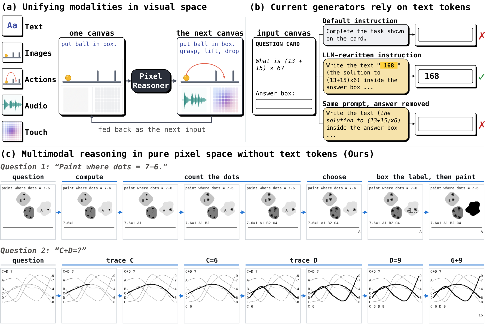
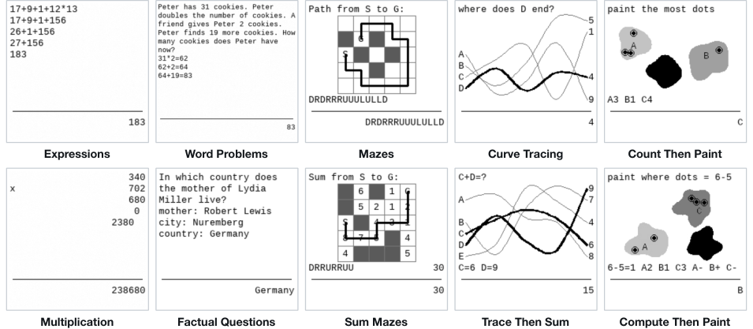
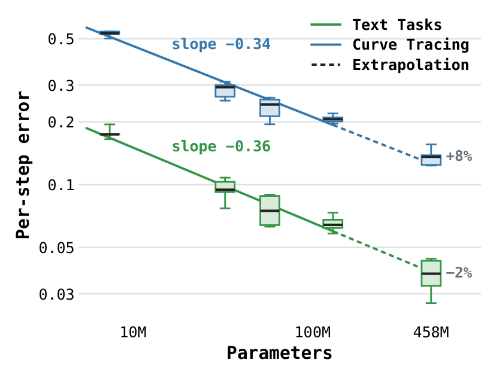
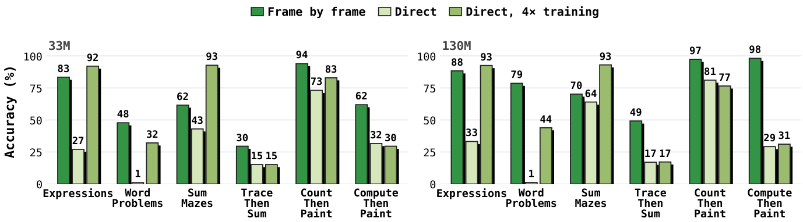
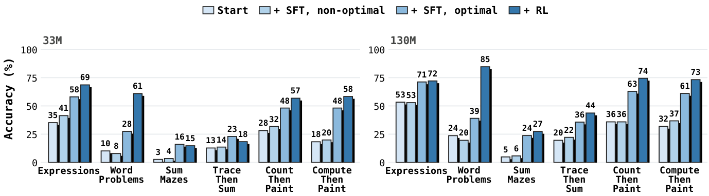
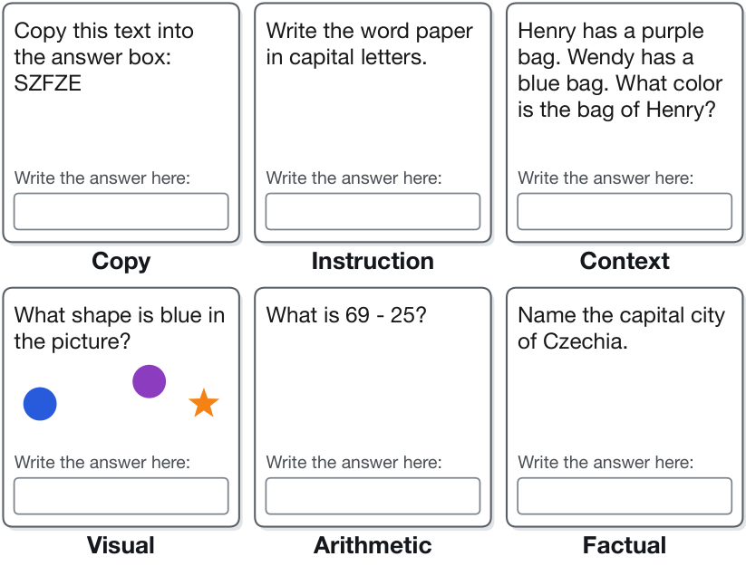

<div align="center">

# Pixel is All You Need

### Multimodal reasoning in pure pixel space, without text tokens

**Jie Chu**<sup>1,2</sup> · **Haoting Shi**<sup>1</sup> · **Fucheng Zhang**<sup>2</sup> · **Jiawei Liu**<sup>1,2</sup> · **Junwei Liao**<sup>1,2</sup> · **Ying Wen**<sup>1,2</sup> · **Muning Wen**<sup>1</sup>

<sup>1</sup>Shanghai Jiao Tong University &nbsp;&nbsp; <sup>2</sup>Shanghai Innovation Institute

<a href="https://bxzzcj.github.io/pixel-is-all-you-need"></a>
<a href="https://arxiv.org/abs/2611.22820"></a>
<a href="LICENSE"></a>


</div>

<p align="center">
  
</p>

> **TL;DR** Text, images, audio, touch and actions can all be drawn on one canvas. A generative model trained from
> scratch on pixels alone, with **no tokenizer, no VAE and no text encoder**, reads a question from the canvas, writes
> its reasoning frame by frame, and draws the answer. It shows the hallmark behaviors of large language models,
> **scaling laws, chain of thought and gains from RL**, and reasons across modalities on the same canvas.

## ✨ Highlights

<table>
<tr>
<td width="25%" valign="top">

**🔍 Generators rely on text**

Open image editing, video and unified multimodal models answer almost nothing written on a canvas. They succeed only
when a text module or prompt rewriter supplies the answer first.

</td>
<td width="25%" valign="top">

**📈 Scaling laws**

Per-step error falls from 0.174 at 7.6M to 0.037 at 458M along a power law. The law fitted up to 130M predicts the
held-out 458M model within 2%.

</td>
<td width="25%" valign="top">

**🧠 Chain of thought**

At 130M, frame-by-frame reasoning solves 98.1% of *Compute Then Paint* against 29.2% for direct answering. On *Word
Problems* it climbs from 3.7% to 78.6% with scale.

</td>
<td width="25%" valign="top">

**🎯 RL post-training**

On *Word Problems* at 130M, GRPO raises accuracy from 23.7% to 84.6%, while supervised fine-tuning with the same
compute reaches at most 39.0%.

</td>
</tr>
</table>

## 📑 Contents

- [Installation](#-installation)
- [Quick start](#-quick-start)
- [Pixel-space models](#-pixel-space-models-secs-47)
- [Reproducing the paper](#-reproducing-the-paper)
- [Benchmark of current generators](#-benchmark-of-current-generators-sec-3)
- [Repository layout](#-repository-layout)
- [Citation](#-citation)
- [License](#-license)

## 🛠 Installation

```bash
git clone https://github.com/bxzzcj/pixel-is-all-you-need.git
cd pixel-is-all-you-need
python -m venv .venv && source .venv/bin/activate

pip install -r requirements.txt safetensors      # pixel models and CPU tests
python -m unittest discover tests                # checks tasks, reader and LoRA on CPU

pip install -r requirements-benchmark.txt        # optional: the generator benchmark (Sec. 3)
```

> [!NOTE]
> Model checkpoints and experiment outputs are not included.

## 🚀 Quick start

Train and evaluate a 33M model that reasons frame by frame on four-step expressions:

```bash
python -m pixel_models.train_text train --task expr:4 --arm video --size S --out runs/expr_video
python -m pixel_models.evaluate --run runs/expr_video --n 1024 --out runs/expr_video/final.json
```

Use `--arm direct` instead to train the same model to answer in a single frame.

## 🧩 Pixel-space models (Secs. 4–7)

The model is a flow-matching transformer on 8×8 pixel patches. Every problem is drawn on a 192×192 canvas: a question
at the top, a rule, and a two-row answer box. The model never sees character codes. Answers are read back from the
pixels by nearest-glyph matching, with no judge model.

| Regime | Flag | What the model learns |
|---|---|---|
| **Frame-by-frame reasoning** | `--arm video` | canvas *t* → canvas *t*+1, each generated frame fed back as the next input. The canvas is the model's only memory |
| **Direct answering** | `--arm direct` | the problem canvas → the final canvas, in one generation |

Both regimes share the model, the data and the training budget. Training problems are generated on the fly, and test
problems come from fixed seeds, so every run of a task sees the same test items.

### Ten tasks, from text to cross-modal

<p align="center">
  
</p>

| Task | Spec | Trainer |
|---|---|---|
| Expressions | `expr:4` | `train_text`, `text_tasks` |
| Multiplication | `mul:4x4` | `train_text` |
| Word Problems | `wp:3` | `text_tasks`, `train_text` |
| Factual Questions | `hop:3` | `train_text` |
| Mazes | `maze:5` | `train_joint` |
| Sum Mazes | `maze:5:sum` | `train_joint` |
| Curve Tracing | `trace:6` | `draw_tasks`, `train_joint` |
| Trace Then Sum | `tracesum:7` | `draw_tasks` |
| Count Then Paint | `countpaint:tallysel` (direct answering: `countpaint`) | `draw_tasks` |
| Compute Then Paint | `countpaint:arithcheck:sel` | `draw_tasks` |

> [!NOTE]
> Word Problems use a 256×256 canvas (`--px 256`) and a batch of 128, because the longer problems need more rows.
> Every other task uses 192×192.

<details>
<summary><b>Module reference</b></summary>

| Module | Contents |
|---|---|
| [`model.py`](pixel_models/model.py) | The flow ViT. Sizes XS 7.6M, S 33M, M 58M, B 130M, L 458M (Tab. 6) |
| [`canvas.py`](pixel_models/canvas.py) | The canvas (24×12 cells of 8×16 px, a rule, a two-row answer box) and the reader |
| [`text_tasks.py`](pixel_models/text_tasks.py) | Expressions, Multiplication, Word Problems, Factual Questions, and a single-GPU trainer |
| [`draw_tasks.py`](pixel_models/draw_tasks.py) | Curve Tracing, Trace Then Sum, Count Then Paint, Compute Then Paint, and their trainer |
| [`maze_tasks.py`](pixel_models/maze_tasks.py) | Mazes and Sum Mazes |
| [`train_text.py`](pixel_models/train_text.py) | Multi-GPU trainer of the text tasks, including the scaling ladder, and per-step metrics |
| [`train_joint.py`](pixel_models/train_joint.py) | Several tasks in one model (cross-modal scaling ladder, Sum Mazes), and per-step metrics |
| [`rl_text.py`](pixel_models/rl_text.py) | GRPO on frame-by-frame rollouts (Sec. 7, text tasks) |
| [`rl_draw.py`](pixel_models/rl_draw.py) | RFT and the SFT controls (Sec. 7, cross-modal tasks) |
| [`evaluate.py`](pixel_models/evaluate.py) | Accuracy on 1,024 fixed problems per test set, used for every main-text number |
| [`scaling_fit.py`](pixel_models/scaling_fit.py) | Power-law fits with a held-out 458M model and seed-bootstrap intervals (Sec. 5.2, Tab. 7) |

</details>

## 📊 Reproducing the paper

<table>
  <tr>
    <td width="36%" align="center"></td>
    <td align="center"><br></td>
  </tr>
  <tr>
    <td align="center"><sub><b>Sec. 5</b> · per-step error follows a power law</sub></td>
    <td align="center"><sub><b>Sec. 6</b> · frame by frame vs. direct answering &nbsp;·&nbsp; <b>Sec. 7</b> · RL vs. SFT</sub></td>
  </tr>
</table>

Each script runs one section in sequence. They are written for clarity rather than scheduling, so split the loops
across GPUs as needed.

| Paper | Command | Notes |
|---|---|---|
| Sec. 5 · Fig. 5 · Tab. 7 | `bash scripts/sec5_scaling.sh` | 5 sizes × 5 seeds × 2 ladders, 132k steps. 458M on 2–4 GPUs |
| Sec. 6 · Fig. 6a | `bash scripts/sec6_cot.sh S` and `B` | 40k steps per regime. Direct answering also 160k |
| Appendix I | `bash scripts/sec6_cot.sh XS` | the 7.6M models |
| Sec. 7 · Fig. 6b | `bash scripts/sec7_rl.sh S` and `B` | uses the Sec. 6 runs of the same size as start models |

Every run directory holds `config.json`, `ckpt.pt` (model, EMA, optimizer, step) and `evals.jsonl`. A restarted run
resumes from `ckpt.pt`. `evaluate.py` writes `final.json`.

<details>
<summary><b>More commands</b></summary>

```bash
# the 458M point of the text ladder on 4 GPUs, then its per-step error
torchrun --standalone --nproc_per_node 4 -m pixel_models.train_text train \
    --task multi:expr:4+mul:4x4+hop:3 --arm video --size L \
    --steps 132000 --decay-from 128000 --seed 0 --out runs/text_L_s0
python -m pixel_models.train_text valloss --run runs/text_L_s0 --val-per-set 4096 --batch 32

# GRPO from a start model trained with 1-3 steps per frame
python -m pixel_models.rl_text --init runs/expr_start/ckpt.pt --task expr:4 --prompt-set k4 \
    --size S --out runs/expr_grpo
```

</details>

<details>
<summary><b>Where each paper number is in the output</b></summary>

Keys are in `final.json` under `sets.<SET>.<KEY>`.

| Paper number | Key |
|---|---|
| Expressions, Word Problems (Sec. 6) | `k4.exact`, `new_k3.exact` |
| Expressions, Word Problems (Sec. 7) | `k4.free`, `new_k3.free` (the model chooses how many frames it draws) |
| Sum Mazes (Sec. 6) | `n3`, `n4`, `n5`: `exact` (the demonstrated path and its total). `valid` accepts any shortest path |
| Sum Mazes (Sec. 7) | `n3`, `n4`, `n5`: `valid` (a shortest path with that path's own total) |
| Trace Then Sum (Sec. 6) | `k3`, `k5`, `k7`: `exact` |
| Count Then Paint, Compute Then Paint (Sec. 6) | `k3.solved`, `arith.solved` (letter, counts, painting IoU ≥ 0.8) |
| Count Then Paint, Compute Then Paint, Trace Then Sum (Sec. 7) | `minimal`: solved in the fewest frames (Trace Then Sum: mean over `k3`, `k5`, `k7`) |
| Per-step error (Sec. 5) | `valloss.json` / `valloss_4k.json`, fitted by `scaling_fit.py` |

</details>

## 🔍 Benchmark of current generators (Sec. 3)

<table>
<tr>
<td width="45%"></td>
<td valign="middle">

Each item is a 1024×1024 canvas with a title, a printed question and an empty answer box. Six tasks span decreasing
answer visibility: **Copy, Instruction, Context, Visual, Arithmetic** and **Factual**
([`tasks.py`](generator_benchmark/tasks.py), [`cards.py`](generator_benchmark/cards.py),
[`render.py`](generator_benchmark/render.py)).

A multimodal judge reads the answer box ([`judge/`](generator_benchmark/judge)).

</td>
</tr>
</table>

| Step | Module |
|---|---|
| Open image editing models: Default, Rewrite, Delete (Tab. 1) | `generate.py` (`--route native` / `rewrite`), `models.py` |
| Prompt rewriters and answer deletion | `rewrite.py`, `delete_answer.py`, `rewrite_prompts/` |
| Closed image editing models | `api_generate.py`, `api_image.py` |
| Video generation models | `video_generate.py`, `video_eval.py` (judged on the final frame) |
| Unified multimodal models: Default, Render, Think | `umm_generate.py`, `bagel_generate.py` |
| LoRA post-training of the generation module (Sec. 3.4, Fig. 3) | `train.py`, `lora.py` |
| BAGEL fine-tuning (Sec. 3.4) | `bagel_train.py`, `bagel_cards.py`, `bagel_replay.py`, `replay_prompts.py`, `bagel_bench.py` |
| Judging and scores | `cases.py`, `judge/run_text.py`, `judge_summary.py` |

<details>
<summary><b>Configuration: weights, upstream code and API keys</b></summary>

Weights and upstream source trees are found through `UMM_MODEL_DIR` and `UMM_SRC_DIR` (defaults `models/` and
`third_party/`). Each adapter documents its expected sub-directory names.

API endpoints and credentials are read from environment variables and have no defaults. Copy `.env.example` to `.env`,
fill in what you need, and load it:

```bash
cp .env.example .env    # .env is ignored by Git
set -a; source .env; set +a
```

| Variable | Used for |
|---|---|
| `JUDGE_BASE_URL`, `JUDGE_API_KEY` | the multimodal judge |
| `REWRITER_BASE_URL`, `REWRITER_API_KEY` | prompt rewriters and the LLM pass of the answer deletion |
| `IMAGE_API_BASE_URL`, `IMAGE_API_KEY` | closed image editing models |
| `VIDEO_API_BASE_URL`, `VIDEO_API_KEY` | closed video generation models |

</details>

## 📁 Repository layout

```
pixel-is-all-you-need/
├── pixel_models/          # Secs. 4–7: tasks, flow ViT, trainers, RL, evaluation, scaling fits
├── generator_benchmark/   # Sec. 3: benchmark cards, model adapters, rewriters, LoRA, judge
├── scripts/               # one script per paper section (sec5_scaling, sec6_cot, sec7_rl)
├── tests/                 # CPU tests of tasks, reader and LoRA
├── assets/                # bundled Liberation fonts and their licenses
└── docs/                  # figures used in this README
```

## 📝 Citation

If you find this work useful, please cite:

```bibtex
@article{chu2026pixel,
  title  = {Pixel is All You Need},
  author = {Chu, Jie and Shi, Haoting and Zhang, Fucheng and Liu, Jiawei and Liao, Junwei and Wen, Ying and Wen, Muning},
  journal = {arXiv preprint arXiv:2611.22820},
  year   = {2026},
  eprint = {2611.22820},
  archivePrefix = {arXiv},
  primaryClass = {cs.CV},
  url = {https://arxiv.org/abs/2611.22820}
}
```

## 📄 License

The code is released under the [MIT License](LICENSE).

Every canvas is drawn with the bundled Liberation 1.07.4 fonts. Pillow's basic text layout is pinned in the code, so
canvases are pixel-identical across machines. The fonts are under a separate license, GNU GPL version 2 with the
Liberation font exceptions. See [`assets/README.md`](assets/README.md), [`assets/License.txt`](assets/License.txt) and
[`assets/COPYING`](assets/COPYING).
